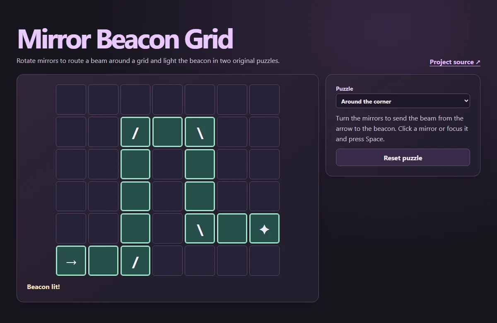

# Mirror Beacon Grid

Rotate mirrors to route a beam around a grid and light the beacon in two original puzzles.

[Open the browser app](https://surfingcoder.com/apps/mirror-beacon-grid/)

## Run locally

Run the following command in this repository and open [localhost:8000](http://localhost:8000).

    python -m http.server 8000

The highlighted tiles mark the path of the beam. Rotate the mirrors until the beam reaches the beacon.

## Verify

Run the following command with Node.js 22 or newer.

    node --test
